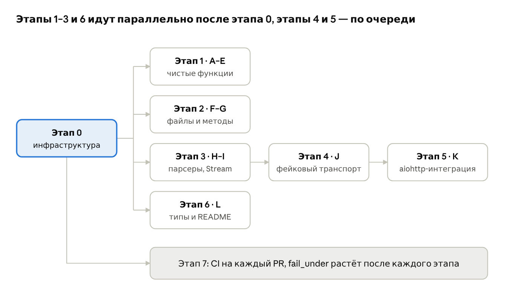

# План покрытия тестами ai-api

Oct 29, 2026 · @Max

## Цели и границы

Цель — покрыть весь пакет `src/ai_api` автоматическими тестами за восемь этапов (0–7) и довести покрытие строк и ветвлений до 95% с проверкой в CI на каждый PR. Сейчас тестов нет: каталога `tests/` не существует, а всё проверенное в версиях 0.0.2 и path parameters проверялось одноразовыми скриптами против локального aiohttp-сервера.

**Что покрываем:**

- **Поведение публичного API:** объявление методов, `send_request`, `stream`, загрузка файлов, ошибки и повторы.
- **Контракты протоколов:** `IAPI`, `IStreamResponse`, парсеры и транспорт `_execute` / `_open_stream`.
- **Защитные проверки:** экранирование параметров пути, отказ в неподдерживаемых типах стрима, проверки при определении класса.
- **Статические типы как часть API:** вывод `T` в `send_request` и `stream` в mypy и pyright.
- **Примеры из README.**

**Принципы:**

- Никакой сети наружу: только локальный сервер `pytest-aiohttp` или фейковый транспорт.
- Детерминированность: реальные задержки повторов и `asyncio.sleep(0.25)` в `close()` подменяются; время, нужное для `timedelta` и `Retry-After`, фиксируется.
- Скорость: весь набор укладывается в 30 секунд, отдельный тест — меньше секунды, кроме двух-трёх тестов таймаутов.
- Каждый найденный ранее баг получает регрессионный тест: импорт `APIError`, `SerializationIterator` вместо файла, двойное кодирование пути.

**Вне рамок:**

- Реальные API провайдеров: готовых клиентов ещё нет.
- SSE и NDJSON: тесты появятся вместе с их реализацией.
- Нагрузочное тестирование и бенчмарки.

## Тестовые зависимости

Группа `test` в `pyproject.toml` покрывает почти всё нужное. Недостаёт одной явной зависимости, `pytest-asyncio`, и одна лишняя, `pytz`.

| Пакет | В pyproject | Зачем в этом проекте | Решение |
| --- | --- | --- | --- |
| `pytest` | `>=9.2.0` | Запуск тестов | Оставить |
| `pytest-aiohttp` | `>=1.1.1` | Фикстура `aiohttp_server`: настоящий локальный сервер для интеграции `AiohttpSession` | Основной инструмент этапа 5 |
| `pytest-asyncio` | нет, приходит транзитивно (1.4.1 в `uv.lock`) | Асинхронные тесты; `asyncio_mode = "auto"` — его настройка | Добавить явно |
| `aresponses` | `>=3.0.0` | Перехват запросов к настоящим именам хостов (`https://api.example.com`) | Только там, где важен сам адрес; остальное — через `aiohttp_server` |
| `pytest-mock` | `>=3.17.0` | Фикстура `mocker`: подмена задержек повторов, часов и `asyncio.sleep` | Оставить |
| `pytest-cov` | `>=7.1.0` | Покрытие строк и ветвлений; `branch = true` уже включён | Оставить |
| `pytest-html` | `>=4.2.0` | HTML-отчёт прогона для артефактов CI | Оставить, только в CI |
| `pytest-mypy` | `>=1.1.0` | Прогон mypy как часть pytest | Только для типовых тестов этапа 6, отдельным запуском |
| `pytz` | `>=2026.5` | Не нужен: код использует `datetime.UTC`, для других часовых поясов есть `zoneinfo` | Убрать |

**Что поправить в конфигурации (этап 0):**

1. **`[tool.pytest.ini_options]`:**
   - `markers = ["integration: тесты с локальным сервером", "typing: проверка типов"]`: без них `--strict-markers` уронит первый же размеченный тест.
   - `asyncio_default_fixture_loop_scope = "function"`: иначе `pytest-asyncio` предупреждает на каждом прогоне.
   - `filterwarnings = ["error"]`: предупреждения об устаревании и незакрытых соединениях становятся ошибками. Именно так ловится утечка ответа после `break` в стриме.
2. **`[tool.coverage.report]`:**
   - добавить в `exclude_also` строку `"^\\s*\\.\\.\\.$"`: тела методов протоколов (`...`) никогда не выполняются и иначе считаются непокрытыми;
   - `fail_under` поднимается по этапам, см. этап 7.
3. **Группа `test`:** добавить `pytest-asyncio`, убрать `pytz`, обновить `uv.lock`.

## Блоки кода

Код делится на 12 блоков трёх уровней. Восемь тестируются без сети и дают большую часть покрытия, остальным нужен фейковый транспорт или локальный сервер.

| Блок | Модули | Уровень | Этап | Риск, если не покрыть |
| --- | --- | --- | --- | --- |
| A. Исключения | `exceptions.py`, `client/exceptions/http.py`, `transport.py` | unit | 1 | Неверный флаг `transient` меняет поведение повторов |
| B. Резолвер ошибок | `client/exceptions/errror_resolver/` | unit | 1 | Ошибки провайдера превращаются не в тот класс, теряется `Retry-After` |
| C. Стратегия повторов | `client/retry/startegy.py` | unit | 1 | Повторы без учёта `Retry-After` |
| D. Сериализация | `client/serialization/` | unit | 1 | Даты, enum и вложенные модели уходят в тело в неверном виде |
| E. Заголовки и auth | `client/headers/`, `client/auth/` | unit | 1 | Токен попадает в `repr` и логи |
| F. Файлы | `types/files.py` | unit | 2 | При повторе уходит обрезанный файл |
| G. Методы | `methods/base.py`, `methods/enums.py` | unit | 2 | Неверный формат ответа, инъекция в путь запроса |
| H. Парсеры и `Stream` | `client/response/` | unit | 3 | Обрезанный текст на границах чанков, strict-поля не проходят |
| I. Построитель тела aiohttp | `client/session/builders/aiohttp.py` | unit | 3 | Файл в JSON-теле или потерянные `filename` / `content_type` |
| J. `BaseSession` | `client/session/base.py` | фейковый транспорт | 4 | Повтор стрима после старта, незакрытые ответы |
| K. `AiohttpSession` | `client/session/aiohttp.py` | integration | 5 | Неправильное сопоставление ошибок aiohttp, утечка соединений |
| L. Типы и README | публичное API, `README.md` | typing / docs | 6 | `send_request` теряет тип, примеры в README перестают работать |

Протоколы (`protocols.py`) и `providers/enums.py` отдельных тестов не получают. Первые проверяются статически на этапе 6, второй — через резолвер в блоке B.

## Этап 0: инфраструктура

Этап 0 создаёт каталог `tests/`, общие фикстуры и два тестовых двойника. На них опираются все остальные этапы. Тестов поведения здесь нет, приёмка — `uv run pytest` проходит на пустом наборе без предупреждений.

**Структура каталога** делит тесты по уровням, а внутри уровня повторяет имена модулей `src/ai_api`, чтобы тест блока находился по пути его модуля:

```text
tests/
├── conftest.py              общие фикстуры и двойники
├── unit/
│   ├── test_exceptions.py   A
│   ├── test_error_resolver.py   B
│   ├── test_retry.py        C
│   ├── test_serialization.py    D
│   ├── test_headers_auth.py     E
│   ├── test_files.py        F
│   ├── methods/             G: inference, path params, query/body
│   ├── test_parsers.py      H
│   ├── test_stream.py       H
│   └── test_body_builder.py     I
├── session/
│   └── test_base_session.py     J, фейковый транспорт
├── integration/             K, marker integration
│   ├── test_aiohttp_requests.py
│   ├── test_aiohttp_uploads.py
│   └── test_aiohttp_streams.py
├── typing/                  L, marker typing
│   └── check_public_api.py
└── docs/
    └── test_readme.py       L
```

**Фикстуры и двойники в `conftest.py`:**

| Фикстура | Что делает | Кто использует |
| --- | --- | --- |
| `no_retry_wait` (autouse) | Подменяет `calculate_wait` в `ai_api.client.session.base` на 0 секунд. Иначе каждый тест повтора ждёт до нескольких секунд | Этапы 4–5 |
| `no_close_delay` (autouse) | Убирает `asyncio.sleep(0.25)` из `AiohttpSession.close()` | Этап 5 |
| `FakeTransport` | Подкласс `BaseSession`. Возвращает заранее заданную очередь ответов или исключений, считает попытки и закрытые ответы | Этап 4 |
| `FakeStreamResponse` | Реализация `IStreamResponse` из списка чанков. Умеет бросить ошибку на n-м чанке и запоминает, вызван ли `aclose()` | Этапы 3–4 |
| `api` | `IAPI`, собирающий URL через `joinpath(..., encoded=True)` как в README, с адресом из `aiohttp_server` | Этап 5 |
| `session` | `AiohttpSession` с `BearerAuth("test-token")` и `BaseErrorResolver`, закрывается в teardown | Этап 5 |
| `recorder` | Приложение aiohttp, которое записывает сырой путь, заголовки, тело и multipart-части запроса и отдаёт ответы по сценарию (статусы, чанки, задержки, обрыв) | Этап 5 |
| фабрики методов | `make_method(base, path=..., fields=...)` создаёт класс метода через `type(...)`. Нужна для параметризованных тестов проверок при определении класса | Этап 2 |

**Правила написания тестов:**

- Одно поведение — один тест. Табличные случаи оформляются через `pytest.mark.parametrize` с `ids`.
- Исключения проверяются через `pytest.raises(..., match=...)`, с проверкой класса и причины (`__cause__`) там, где она есть.
- Классы методов, которые должны упасть при определении, объявляются внутри `pytest.raises`, а не на уровне модуля: иначе падает сбор всего файла.
- На тесты распространяются правила ruff проекта. Для `tests/` отключаются `D` (docstrings) и `PLR2004` (числа в assert) через `per-file-ignores`.

## Этап 1: чистые функции (блоки A–E)

Этап 1 покрывает модули без ввода-вывода и без асинхронности, с целью 100% покрытия этих файлов. Приёмка — все пункты ниже отмечены, а отчёт `--cov` по блокам A–E не показывает пропущенных строк.

**A. Исключения**

- [ ] `AIAPIError`: сообщение из `default_message` + `"detail: …"`, только одно из них, ни одного; подстановка `kwargs` в шаблон.
- [ ] `APIError`: все атрибуты сохраняются; `transient` по умолчанию `False`.
- [ ] `HTTP_ERRORS`: каждый статус ведёт на свой класс, все классы — подклассы `APIError` с `default_message`.
- [ ] Транспортные ошибки: `APIConnectionError` и `APITimeoutError` временные, `APITLSError` нет; `APIResponseError` хранит `status`.
- [ ] Регрессия: `ai_api.client.exceptions.errror_resolver.protocols` импортируется без ошибки.

**B. Резолвер ошибок**

- [ ] `get_header` без учёта регистра и с отсутствующим заголовком; `optional_str` для не-строк.
- [ ] `parse_retry_after`: число секунд, HTTP-дата в будущем, дата в прошлом (`0.0`), дата без часового пояса, мусор, `inf` / `nan`, отрицательное число. Текущее время фиксируется через `mocker`.
- [ ] `resolve`: тело `None`, не `Mapping`, без `error`, `error` не объект; порядок `x-request-id` → `request-id` → `body.request_id`.
- [ ] `classify`: набор временных статусов 408, 500, 502, 503, 504, 529; 429 временный только при `Retry-After`; неизвестный статус → `APIError`.
- [ ] Подкласс из README (`ExampleErrorResolver`): `provider`, переопределённый `classify` и `get_error_code`.

**C. Стратегия повторов**

- [ ] `should_retry` для `APIError`, `APITransportError`, постороннего исключения.
- [ ] `calculate_wait`: без исхода, с ошибкой без `retry_after`, с `retry_after` больше джиттера (берётся он) и меньше (берётся джиттер). `RetryCallState` создаётся вручную, джиттер проверяется по границам 0–30 с.

**D. Сериализация**

- [ ] `dumps` / `loads`: круговой прогон, `loads` от неверного JSON даёт подкласс `ValueError`.
- [ ] `BodyNormalizer`: `None` выбрасывается на любой глубине; `InputFile` и читаемый поток проходят как есть; закрытый поток — `ValueError`.
- [ ] Вложенная `BaseAPIType` становится словарём; enum — его значением; aware-дата — строкой Unix-времени; naive-дата — `ValueError`; `timedelta` — «сейчас + дельта» при зафиксированном времени.

**E. Заголовки и auth**

- [ ] `Headers`: `add` перезаписывает без учёта регистра; `build` не меняет исходные заголовки и даёт приоритет `extra`; `copy` независим.
- [ ] `SERVER_SOFTWARE` содержит `ai_api/<__version__>`.
- [ ] `BearerAuth`: `encode()`, отказ для пустого токена и токена с пробелом, токен не попадает в `repr`.

## Этап 2: файлы и методы (блоки F–G)

Этап 2 фиксирует контракт объявления методов — самую сложную и чаще всего менявшуюся часть кода. Цель — 100% строк и ветвлений `methods/base.py` и `types/files.py`. Задержек и сети нет, файлы на диске создаются в `tmp_path`.

**F. Файлы (`types/files.py`)**

- [ ] `guess_content_type`: известное расширение, неизвестное, `None`.
- [ ] `InputFile.from_value`: `InputFile`, `bytes` / `bytearray` / `memoryview`, `Path`, `BytesIO`, `FileIO`, текстовый поток и строка (оба → `None`).
- [ ] Поле `file: InputFile` принимает сырые значения, `file: PathFile` отклоняет `bytes`, текст ошибки называет класс. `model_dump()` возвращает тот же объект.
- [ ] `BytesFile`, `PathFile`: `open()` даёт полное содержимое при каждом вызове; `PathFile` читает чанками не больше `chunk_size`; `filename` берётся из пути.
- [ ] `IOFile`: чтение с позиции на момент создания, повторное `open()` отдаёт то же; неперематываемый поток читается один раз, второй раз — `RuntimeError`; закрытый поток — `ValueError`; `filename` из `.name`.
- [ ] `StreamFile`: `reusable is False`, второе `open()` — `RuntimeError`.
- [ ] `repr` не содержит содержимого файла.

**G1. Вывод типа и формата ответа**

- [ ] `BaseAPIMethod[Model]` / `[str]` / `[bytes]` / `[None]` → JSON / TEXT / BYTES / NONE и соответствующий `__returning__`.
- [ ] Явный `__response_format__` и явный `__returning__` сильнее вывода; формат, заданный в промежуточном `Mid[T]`, наследуется.
- [ ] Аргумент не класс (`list[int]`, `TypeVar`) не ломает определение класса; сами базовые классы не меняют свои значения по умолчанию.
- [ ] Стрим: `[bytes]` / `[str]` принимаются; `[Model]`, `[None]`, `[int]` — `TypeError` при определении; явный формат или свой `__stream_parser__`, в том числе в собственном базовом `SseBase[T]`, снимает ошибку.

**G2. Параметры пути**

- [ ] Подстановка нескольких параметров, enum → значение, `bool` → `true`/`false`, `{{literal}}`.
- [ ] Экранирование: `../admin`, `a/b?x=1#f`, кириллица, пробел, `50%`; с `__path_safe__ = "/"` слеш сохраняется.
- [ ] `ValueError` для `None`, `""`, `.`, `..`, а с `__path_safe__ = "/"` — для `a/../b`, `a//b`, `../x`.
- [ ] `TypeError` при определении: нет поля, `{}`, `{a.b}`, `{a[0]}`, `{a:>5}`, `{a!r}`, незакрытая `{`, пересечение с query — в том же классе и в подклассе.
- [ ] Подкласс без своего пути наследует `__request_path_params__`.

**G3. Query, body и повторы**

- [ ] `get_query_map`: `None`-поля пропускаются, `bool` → `true`/`false`, алиасы, enum; без `__request_query__` → `None`.
- [ ] `get_body_map`: без полей пути и query, без `None`, по алиасам, с лишними полями (`extra="allow"`).
- [ ] `model_post_init`: сырой бинарный поток в поле `Any`, в списке и в словаре становится `IOFile`; текстовый поток — `ValidationError`. Регрессия: в `get_body_map()` нет `SerializationIterator`.
- [ ] `retryable`: `__retryable__` выключен; включён; включён, но есть `StreamFile` в поле, списке или вложенной модели.

## Этап 3: парсеры, Stream и построитель тела (блоки H–I)

Этап 3 проверяет преобразование байтов в результат и обратно, не касаясь сети. Ответы собираются вручную как `BufferedResponse` или `FakeStreamResponse`. Цель — 100% `client/response/` и `builders/aiohttp.py`.

**H1. `BufferedResponseParser`**

- [ ] JSON: стандартный декодер проходит через `model_validate_json` — strict-поля `datetime`, `UUID`, `StrEnum` принимают строки (регрессия по замечанию CodeRabbit).
- [ ] JSON: свой `json_loads` вызывается и идёт через `model_validate`; strict-поля с ним отклоняются — зафиксировать как документированное поведение.
- [ ] JSON: битый JSON и несоответствие схеме → `APIResponseError` со статусом; метод без модели → `TypeError`.
- [ ] TEXT: charset из ответа, `utf-8` по умолчанию, неверная кодировка и неизвестный charset → `APIResponseError`.
- [ ] BYTES возвращает тело как есть; NONE — `None` для пустого тела и `APIResponseError` для непустого; SSE / NDJSON → `ValueError`.

**H2. `StreamResponseParser` и `Stream`**

- [ ] BYTES: чанки отдаются без изменений и в том же порядке.
- [ ] TEXT: символ из 2, 3 и 4 байтов, разорванный на каждой позиции (параметризация); завершающий `final=True`; пустые куски не отдаются.
- [ ] TEXT: неизвестный charset и оборванная последовательность в конце потока → `APIResponseError`.
- [ ] Неподдерживаемый формат → `ValueError` сразу при вызове `parse`, до итерации.
- [ ] `Stream.aclose()` закрывает генератор и не падает на обычном итераторе; `Stream.save()` пишет файл в `tmp_path` и возвращает число байтов.

**I. `AiohttpBodyBuilder`**

- [ ] `NONE` → `{}`; `JSON` → `{"json": …}` с нормализованными значениями; `FORM` и `MULTIPART` → `{"data": FormData}`.
- [ ] Файл, `bytes` или поток на любой глубине JSON-тела → `TypeError`; файл в `FORM` → `TypeError`; текстовый поток → `TypeError`.
- [ ] Поля формы: список → повторяющееся поле, словарь → JSON-строка, `bool` → `true`/`false`, число → строка.
- [ ] Содержимое `FormData` (имя, `filename`, `content_type`) проверяется на этапе 5 на настоящем сервере, а не через внутренние атрибуты `FormData`, которые меняются между версиями aiohttp.

## Этап 4: BaseSession на фейковом транспорте (блок J)

Этап 4 проверяет общую логику сессии через `FakeTransport`. Это подкласс `BaseSession`, чьи `_execute` и `_open_stream` отдают заранее заданные ответы и исключения. Так повторы и закрытие ответов проверяются по точному числу вызовов, без сети и без нестабильности. Цель — 100% `client/session/base.py`.

**`send_request`**

- [ ] Успешный ответ разбирается парсером метода; парсер получает `json_loads` сессии.
- [ ] Ответ ≥ 400 → ошибка от резолвера; тело не JSON → резолвер получает `body=None`.
- [ ] `ValueError` или `UnicodeError` из парсера → `APIResponseError` с исходной ошибкой в `__cause__`.
- [ ] Неповторяемый метод: ровно 1 попытка даже при 503.
- [ ] Повторяемый метод: 503 → 503 → 200 даёт 3 попытки и результат; 4 ответа 503 дают `ServiceUnavailableError` после 4 попыток; 404 и 429 не повторяются; `APIConnectionError` повторяется, `APITLSError` нет.
- [ ] Ожидание между попытками берётся из `calculate_wait`: тест проверяет, что подменённая `calculate_wait` вызвана между попытками и что в `state.outcome` лежит ошибка предыдущей попытки с её `retry_after`. Внутренний sleep tenacity не патчится.
- [ ] Метод с `StreamFile` при `__retryable__ = True` делает 1 попытку.

**`stream`**

- [ ] Успешное открытие: элементы приходят через `Stream`, после выхода из блока у ответа вызван `aclose()` ровно один раз.
- [ ] Ответ ≥ 400: тело прочитано, ответ закрыт, ошибка выброшена при входе в `async with`; тело блока не выполнялось.
- [ ] Повтор на открытии: 503 → 200; закрыт каждый промежуточный ответ.
- [ ] Ошибка на n-м чанке доходит до вызывающего и не повторяется: одна попытка даже при `__retryable__ = True`, ответ закрыт.
- [ ] `break` и исключение внутри блока: генератор парсера и ответ закрыты, исключение не подменено.
- [ ] Неподдерживаемый формат (`ValueError` из `parse`) до `yield`: ответ всё равно закрыт.
- [ ] Отмена задачи (`asyncio.CancelledError`) во время итерации тоже закрывает ответ.

**Жизненный цикл:** `async with session` вызывает `close()` и при обычном выходе, и при исключении.

## Этап 5: интеграция AiohttpSession (блок K)

Этап 5 запускает настоящий `AiohttpSession` против сервера из фикстуры `aiohttp_server` и проверяет то, что сервер действительно получил: сырой путь, заголовки, тело, multipart-части. Эти тесты помечены `@pytest.mark.integration`. Основа — сценарии, которые уже проверялись вручную скриптами в ходе разработки 0.0.2. Цель — 100% `client/session/aiohttp.py`.

**Запросы (`test_aiohttp_requests.py`)**

- [ ] Заголовки: `Authorization: Bearer …`, `User-Agent` с версией, дополнительные из `Headers`.
- [ ] JSON-тело, форма, query-параметры и путь с параметрами в одном запросе. Регрессия: `..%2Fadmin`, кириллица и `50%` приходят без двойного `%25`.
- [ ] Ответы JSON, текст в не-UTF-8 charset, байты, пустой `204`.
- [ ] Ошибки: 404 с телом провайдера → `NotFoundError` с `code` и `request_id`; 503 → 503 → 200 с `__retryable__` → 3 запроса на сервере; 429 с `Retry-After`.
- [ ] Таймауты: обработчик спит дольше `timeout=ClientTimeout(total=0.2)` → `APITimeoutError`.
- [ ] Транспорт: закрытый порт → `APIConnectionError`; сервер обрывает тело с `Content-Length` → `APIResponseError`.
- [ ] TLS: сервер с самоподписанным сертификатом → `APITLSError`. Сертификат генерируется в фикстуре; если нужная библиотека недоступна, тест пропускается, см. риски.
- [ ] Жизненный цикл: сессия создаётся лениво, `close()` можно вызвать дважды, после `close()` следующий запрос создаёт новую `ClientSession`.

**Загрузки (`test_aiohttp_uploads.py`)**

- [ ] `PathFile`, `BytesFile`, `IOFile`, `StreamFile`, сырые `bytes` и сырой `BytesIO` в поле `Any`: сервер получает файл целиком (сравнение по хешу), с верными `filename` и `Content-Type`.
- [ ] Файл больше `DEFAULT_CHUNK_SIZE` (например, 300 КБ) и список файлов в одном поле.
- [ ] Повтор после 503 для `PathFile`, `IOFile` и сырого `BytesIO`: на третьей попытке файл полный; для `StreamFile` — только одна попытка.

**Стримы (`test_aiohttp_streams.py`)**

- [ ] Чанки приходят по мере отправки: первый чанк получен раньше, чем сервер отправил последний. Синхронизация через `asyncio.Event`, а не замер времени.
- [ ] Текстовый стрим с разорванным UTF-8 символом; `save()` для 1 МБ.
- [ ] 404 при входе; повтор открытия после 503; обрыв соединения сервером посредине стрима → `APIResponseError`.
- [ ] `stream_timeout=ClientTimeout(sock_read=0.3)` и пауза сервера → `APITimeoutError` после первого чанка; общий `timeout` сессии на стрим не действует.
- [ ] `break` из бесконечного стрима: в коннекторе не осталось занятых соединений, следующий запрос работает, нет `ResourceWarning` (ловится `filterwarnings = error`).

## Этап 6: типы и README (блок L)

Этап 6 закрепляет статические типы как часть публичного API и примеры из README. И то и другое уже ломалось без изменения поведения: pyright отклонял классы методов, а `build_url` из README кодировал путь дважды.

**Проверка типов (`tests/typing/check_public_api.py`)** — файл не запускается, его проверяют mypy и pyright:

- [ ] `assert_type(await session.send_request(Method()), Model)` для модели, `str`, `bytes`, `None`; `assert_type(stream, Stream[bytes])` и `Stream[str]` в `async with session.stream(...)`.
- [ ] Негативные случаи: `send_request(stream_method)`, `stream(buffered_method)`, `Stream[str].save()`. Каждая строка помечена `# type: ignore[arg-type]` (или `[misc]`). С `warn_unused_ignores = true` неиспользованный ignore сам станет ошибкой, то есть пропавшая ошибка типа роняет проверку. Для pyright то же делает `# pyright: ignore[…]` с `reportUnnecessaryTypeIgnoreComment`.
- [ ] `AiohttpSession` присваивается `ISession`; класс метода без аннотаций `ClassVar` присваивается `IAPIMethod[T]` — регрессия по проблеме с pyright.
- [ ] Запуск: `uv run pytest --mypy -m mypy tests/typing` (через `pytest-mypy`) и отдельный шаг pyright в CI. Локально на машине с заблокированным скомпилированным mypy этот шаг не запускается: `pytest-mypy` помечает свои элементы маркером `mypy`, и обычный `uv run pytest` без `--mypy` их не собирает.

**README (`tests/docs/test_readme.py`)**

- [ ] Тест извлекает все блоки ```` ```python ```` из `README.md` и проверяет их число. Новый пример без теста ломает сборку и напоминает его дописать.
- [ ] Примеры выполняются в зарегистрированном в `sys.modules` модуле (без этого pydantic не создаёт параметризованные классы). `base_url` подменяется на `aiohttp_server`.
- [ ] Проверяется то, что обещает текст README: тело запроса быстрого старта, `"/models/example-1"`, `?limit=5`, имена и MIME-типы трёх загрузок, `StreamFile` не повторяется, сохранённый файл и текст стрима, `QuotaExceededError` из резолвера.

## Этап 7: CI и порог покрытия

Этап 7 делает тесты обязательным условием слияния. Сейчас в репозитории нет CI-конфигурации: две проверки в PR — это CodeRabbit и GitGuardian, тесты никто не запускает. Порог `fail_under` растёт вместе с этапами, чтобы каждый завершённый этап фиксировал достигнутое и покрытие не откатывалось.

| После этапа | `fail_under`, % | Что запускается |
| --- | --- | --- |
| 0 | — | `uv run pytest` на пустом наборе |
| 1 | 73 | unit A–E |
| 2–3 | 96 | + F–I |
| 4 | 97 | + J, фейковый транспорт |
| 5 | 98 | + K, integration |
| 6 | 98 | + typing и README |

Проценты — фактическое покрытие после этапа, округлённое вниз (этапы 2 и 3 делались вместе). Итоговый порог в `pyproject.toml` — `fail_under = 98`.

**GitHub Actions (`.github/workflows/tests.yml`)**, на каждый PR и push в `master`, Python 3.15, `uv sync --all-groups --locked`:

1. `uv run ruff check src tests` и `uv run ruff format --check src tests`
2. `uv run mypy src` и pyright по конфигурации из `pyproject.toml`
3. `uv run pytest --cov --cov-branch --cov-report=xml --html=report.html --self-contained-html` на Ubuntu и Windows
4. `uv run pytest --mypy -m mypy tests/typing`
5. Артефакты: `coverage.xml` и `report.html` для каждой ОС.

Шаги 1, 2 и 4 идут одной задачей на Ubuntu, шаг 3 — матрицей по ОС с `fail-fast: false`, чтобы падение на одной ОС не скрывало результат другой.

**pre-commit (`.pre-commit-config.yaml`)**, ставится один раз командой `uv run pre-commit install`: базовые проверки из `pre-commit-hooks`, `uv-lock`, `ruff-check --fix` и `ruff-format` (только для Python, чтобы не переформатировать примеры в README) и pyright через `uv run`. mypy подключён на ручной стадии из-за заблокированного скомпилированного mypy: `uv run pre-commit run mypy --hook-stage manual --all-files`. Версии хуков совпадают с версиями в `uv.lock`.

**Порядок внедрения.** Этап 0 идёт первым. Этапы 1–3 не зависят друг от друга и могут идти параллельно. Этап 4 ждёт `FakeStreamResponse` из этапа 3, этап 5 — правильное поведение сессии из этапа 4. Этап 6 нуждается только в этапе 0, а CI из этапа 7 можно включить сразу после этапа 0 и поднимать порог по мере готовности. Схема зависимостей — ниже.



Критический путь — этапы 0 → 3 → 4 → 5. Блоки 1, 2 и 6 можно раздать другим людям или сессиям и делать параллельно.

## Риски и открытые вопросы

| Риск | Чем грозит | Что делать |
| --- | --- | --- |
| Скомпилированный mypy (`librt`) заблокирован политикой Windows на машине разработчика | `pytest --mypy` не запускается локально | Типовые тесты идут отдельным шагом и обязательны только в CI |
| Тесты таймаутов и инкрементальной доставки зависят от времени | Нестабильные падения на медленном CI | Синхронизация через `asyncio.Event`, запас минимум в 3 раза между таймаутом и паузой сервера |
| TLS-тесту нужен самоподписанный сертификат | Новая тестовая зависимость (например, `trustme`) | Решить на этапе 5; без неё ветка `APITLSError` покрывается подменой исключения через `mocker` |
| Тесты фиксируют спорное текущее поведение | Исправление потом потребует правки тестов | Помечать такие тесты комментарием со ссылкой на решение из открытых вопросов |
| Проверка освобождения соединений читает `connector._acquired` | Внутренний атрибут aiohttp может исчезнуть | Основной сигнал — `ResourceWarning` при `filterwarnings = error` и успешный следующий запрос |

**Открытые вопросы:**

- [x] 429 сейчас не повторяется. Оставить так и зафиксировать тестом или сначала включить повтор с учётом `Retry-After`? Решено 29.10.2026 (аудит): 429 повторяется только при `Retry-After`, и не дольше `max_retry_after` (60 с).
- [ ] Обрыв соединения посредине стрима сейчас даёт `APIResponseError`. Оставить или перевести на `APIConnectionError` до написания тестов этапа 5?
- [ ] Даты в теле сериализуются строкой Unix-времени даже в JSON. Это намеренно? OpenAI и Anthropic ожидают числа или ISO-строки.
- [x] Нужен ли прогон на нескольких ОС (Windows, Linux) в CI? Чтение файлов и пути ведут себя по-разному. Решено: pytest идёт матрицей Ubuntu + Windows.
